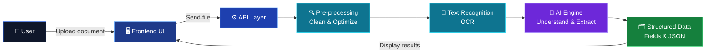

<div align="center">


### Scan it. Understand it. Extract it. Instantly.

<p>
  <a href="https://docscanai.vercel.app/">
    
  </a>
  <a href="https://github.com/sathi2305/DOCSCAN-AI-Github">
    
  </a>
</p>

<p>
  
  
  
  
</p>

**[🌐 Live Demo](https://docscanai.vercel.app/)** &nbsp;•&nbsp; **[✨ Features](#-features)** &nbsp;•&nbsp; **[🏗️ Architecture](#️-architecture)** &nbsp;•&nbsp; **[🛠️ Tech Stack](#️-tech-stack)** &nbsp;•&nbsp; **[⚙️ Getting Started](#️-getting-started)**

</div>

---

<div align="center">

## 📌 Overview

</div>

<p align="center">
<b>DocScan AI</b> turns documents into clean, structured, usable data.<br/>
Upload a document, let the AI read it, and get organized results in seconds, with no manual typing.
</p>

<div align="center">

## 🚀 Live Deployment

| 🔗 Resource | 📍 Link |
|:---:|:---:|
| **Live Application** | [**docscanai.vercel.app**](https://docscanai.vercel.app/) |
| **Source Code** | [**github.com/sathi2305/DOCSCAN-AI-Github**](https://github.com/sathi2305/DOCSCAN-AI-Github) |

</div>

---

<div align="center">

## ✨ Features

</div>

<div align="center">

| 📄 Smart Scanning | 🧠 AI Extraction | ⚡ Fast Results |
|:---:|:---:|:---:|
| Upload documents and images with a clean, simple interface | Reads content and pulls out key fields intelligently | Structured output delivered in seconds |

| 🔍 Text Recognition | 🗂️ Structured Output | 🌐 Cloud Deployed |
|:---:|:---:|:---:|
| Accurate text detection from scanned files | Organized, readable, export-ready data | Always available on Vercel, nothing to install |

</div>

---

<div align="center">

## 🏗️ Architecture

</div>



<div align="center">

| Layer | Responsibility |
|:---:|:---|
| **🖥️ Frontend** | Upload interface, live preview, and results display |
| **⚙️ API Layer** | Receives files, validates input, orchestrates the pipeline |
| **🔍 Pre-processing** | Cleans and optimizes the document for better accuracy |
| **📝 Recognition** | Detects and reads the text inside the document |
| **🧠 AI Engine** | Understands context and extracts meaningful fields |
| **🗂️ Output** | Returns clean, structured data ready to use |

</div>

---

<div align="center">

## 🛠️ Tech Stack


</div>

---

<div align="center">

## ⚙️ Getting Started

</div>

```bash
# 1️⃣ Clone the repository
git clone https://github.com/sathi2305/DOCSCAN-AI-Github.git

# 2️⃣ Move into the project
cd DOCSCAN-AI-Github

# 3️⃣ Install dependencies
npm install

# 4️⃣ Start the development server
npm run dev
```

Open **http://localhost:3000** in your browser.

---

<div align="center">

## 🔄 How It Works

</div>

<div align="center">

```
 📤 Upload  ➜  🔍 Pre-process  ➜  📝 Recognize  ➜  🧠 Extract  ➜  ✅ Results
```

</div>

---

<div align="center">

## 🤝 Contributing

Contributions, issues, and feature requests are welcome.<br/>
Fork the repo, create a branch, and open a pull request.

## 👨‍💻 Author

**Sathiyamoorthi S**<br/>
V.S.B College of Engineering Technical Campus, Coimbatore

[](https://github.com/sathi2305)

<br/>

### ⭐ If you like this project, give it a star!


</div>
